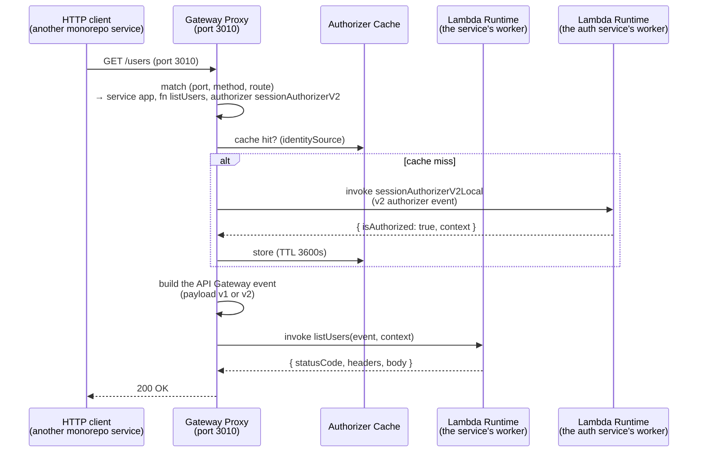

# PRD — API Gateway emulation and a Lambda runtime (replacing serverless-offline)

| | |
|---|---|
| **Status** | Proposal |
| **Date** | 2026-07-08 |
| **Area** | Orchestrator (server + UI), the `serverless-lss` plugin, `LssClient`, CLI |
| **Related docs** | [README.md](README.md) (the orchestrator's original proposal), [FEATURES.md](FEATURES.md), [CONFIGURATION.md](CONFIGURATION.md) |

---

## 1. Context and problem

LSS was born to remove the cost of every microservice in the monorepo booting its own LocalStack: a single control plane provisions DynamoDB, SQS, SNS and S3 from the CloudFormation template `sls package` generates. That solved the **async/data** side of local development.

The **synchronous** side is still expensive: every module still needs its own `serverless offline` process to expose the HTTP APIs and the Lambda invoke endpoint. In a monorepo with 15+ microservices that means 15+ heavy Node processes (each with its own Serverless Framework bootstrap, its own watchers and its own build), burning memory and CPU even for services the developer is not touching.

Today serverless-offline is in fact a **structural dependency** of LSS: the Lambda proxies generated in LocalStack forward SQS/Streams/S3 events over HTTP to serverless-offline's invoke endpoint (`POST /2015-03-31/functions/{name}/invocations` on `lambdaPort`).

**This PRD proposes LSS's natural next step**: the orchestrator itself registering each service's endpoints and Lambdas (from the `sls package` artifacts, as it already does for the other resources), exposing the APIs on multiple ports through a light proxy and executing the handlers directly — making serverless-offline optional and, in practice, replaceable.

### Why now

- The original proposal ([README.md](README.md), "Execution bridge") already planned to "load and invoke the .zip or source" directly; the implementation went the proxy → serverless-offline route out of pragmatism. The foundation (CFN parser, service cache, ProcessManager, auto-package) already exists.
- The original decision to **ignore API Gateway when parsing** ("not useful locally") was correct while serverless-offline covered HTTP. The moment we take over that role, API Gateway becomes useful locally and the decision flips.
- The network contract is already fixed: LocalStack's proxies post to AWS's standard invoke endpoint. If LSS answers on that same port with the same API, **the existing event source mappings keep working with no change at all**.

## 2. Goals

1. **Register** every Lambda function and HTTP route (API Gateway REST API v1 and HTTP API v2) of each service at `sls package` time, with no custom manifest — using the artifacts the Serverless Framework already generates in `.serverless/`.
2. **Expose the APIs on multiple ports** (one 30xx port per service, preserving the ports the monorepo already uses) through a multi-port proxy inside the orchestrator itself — no existing call in the monorepo has to change.
3. **Execute the handlers** locally (TypeScript and JavaScript), with environment variables, timeout and a `context` faithful to real Lambda.
4. **Expose an AWS-compatible Lambda invoke** (`POST /2015-03-31/functions/{name}/invocations`) on a 130xx port per service — every registered Lambda is invocable, including the ones with no HTTP event (scheduled, queue consumers and so on).
5. **Support Lambda authorizers** (`request`, payload 1.0 and 2.0, `enableSimpleResponses`, caching by `resultTtlInSeconds`), including when the authorizer lives in **another service** of the monorepo.
6. **UI**: new **Lambdas** and **APIs** menus in the dashboard, showing what is registered, online and invocable.
7. **Hot reload**: changes to a registered service's source update the Lambda in LSS automatically.

### Non-goals (for this iteration)

- **Emulating scheduled triggers** (`schedule`/EventBridge cron): left as a TODO — but scheduled Lambdas **are registered and invocable** by hand (UI, invoke API, `LssClient`).
- WebSocket APIs (`websocket` events).
- Non-proxy API Gateway integrations (VTL templates, mocks, HTTP integrations), API keys/usage plans, request validators, custom domains.
- JWT authorizers (HTTP API's `type: jwt`) and Cognito — future work; the scope here is Lambda authorizers.
- Emulating API Gateway payload limits/quotas.

## 3. Solution overview

Three new blocks in the orchestrator, plus extensions to the plugin, the UI and `LssClient`:

1. **Function & Route Registry** (control plane): the parser starts extracting functions + HTTP events + authorizers from the `sls package` artifacts. The registration lands in the existing service cache (`~/.lss/orchestrator/cache/<service>/`).
2. **Lambda Runtime** (data plane): one light Node worker per service loads and executes the handlers (compiled artifact or source), with faithful env/timeout/context.
3. **Multi-port Gateway Proxy** (data plane): per service, the orchestrator opens the API port (30xx) speaking "API Gateway" and the invoke port (130xx) speaking "AWS Lambda Invoke API".



The existing asynchronous event flow **does not change**: LocalStack's Lambda proxies go on posting to `http://host.docker.internal:<invokePort>/2015-03-31/functions/{name}/invocations` — it is just that what answers on that port is now the LSS Lambda Runtime, not serverless-offline.

```
BEFORE  SQS msg → LocalStack ESM → Lambda proxy → HTTP invoke :13010 → serverless-offline → handler
AFTER   SQS msg → LocalStack ESM → Lambda proxy → HTTP invoke :13010 → LSS Lambda Runtime → handler
```

## 4. Functional requirements

### RF1 — Registering functions and routes at `sls package`

- **RF1.1**: On `sls package` (the existing `after:package:finalize` hook), the service is registered with **all** of its Lambda functions: short name, full name (`{service}-{stage}-{fn}`), handler, runtime, memory, timeout, env vars and triggers.
- **RF1.2**: `http` (REST API / payload v1) and `httpApi` (HTTP API / payload v2) events are extracted with method, path, cors and the authorizer reference. `ANY` and greedy paths (`{proxy+}`, `$default`) are supported.
- **RF1.3**: Authorizers declared in the service (under `provider.httpApi.authorizers` for v2; inline on the `http` event for v1) are registered with `type`, `identitySource`, `resultTtlInSeconds`, `enableSimpleResponses`, `payloadVersion` and the target (a local `functionName` or an external `arn`).
- **RF1.4**: The source of truth stays the `sls package` artifacts — no custom manifest. The parser reads `.serverless/serverless-state.json` (functions, events and authorizers with variables resolved) alongside the `cloudformation-template-update-stack.json` already in use today (resources, env vars, full names).
- **RF1.5**: The plugin starts sending the service's API port (`apiPort`) too, with the same discovery strategy as `invokePort` (see §5.12). Old payloads (without `apiPort`) are still accepted.
- **RF1.6**: Re-registration is idempotent and diffs: routes/functions removed from serverless.yml disappear from the registry; changed ports rebind the listeners.

### RF2 — Lambda Runtime (executing TS/JS handlers)

- **RF2.1**: Every registered service gets a dedicated **worker process** that loads and executes handlers on demand (lazily, with a module cache — the "warm start").
- **RF2.2**: A configurable handler-resolution strategy (`execution`):
  - **`artifact`**: extracts the `.zip` produced by `sls package` (cached in `~/.lss/orchestrator/runtime/<service>/`) and `require`s the compiled handler. Works uniformly for TS and JS, since the bundlers (serverless-esbuild/webpack) already emitted JS.
  - **`source`**: `require`s the source directly from `servicePath`. For `.ts` handlers it registers a loader (`esbuild-register`/`tsx`) in the worker. Better for hot reload (no repackage).
  - **`auto`** (default): `artifact` when the artifact exists and is up to date; otherwise `source`.
- **RF2.3**: A handler's env vars = `provider.environment` + `functions.<fn>.environment` (from CFN/state), applied in the service's worker. One worker per service guarantees env isolation between services (functions of the same service share a process — the same behaviour as serverless-offline).
- **RF2.4**: A faithful `context`: `functionName` (full), `functionVersion: '$LATEST'`, `memoryLimitInMB`, `awsRequestId`, `getRemainingTimeInMillis()`, a synthetic `invokedFunctionArn`.
- **RF2.5**: The timeout from `functions.<fn>.timeout` (or the provider default) is enforced; an overrun answers with a Lambda-shaped error (`Task timed out after N seconds`) without taking the worker down.
- **RF2.6**: The handler's `console.*` is captured per invocation (a ring buffer, like today's process log) and exposed in the UI/API.
- **RF2.7**: A worker crash does not take the orchestrator down; the worker is restarted and the service's status reflects the error.

### RF3 — Invoke API (port 130xx)

- **RF3.1**: Per service, the orchestrator opens a listener on `invokePort` implementing `POST /2015-03-31/functions/{functionName}/invocations` (accepting both the short and the full name).
- **RF3.2**: The `X-Amz-Invocation-Type` header is honoured: `RequestResponse` (200, synchronous response), `Event` (202, fire-and-forget), `DryRun` (204). A handler error → 200 with an `X-Amz-Function-Error: Unhandled` header and a Lambda-shaped error payload (compatible with the AWS SDK).
- **RF3.3**: **Every** registered Lambda is invocable through that port — including those with no HTTP event (scheduled, consumers). It is the same contract LocalStack's Lambda proxies already use, which guarantees compatibility with no provisioner change.
- **RF3.4**: Invocation is also available through the orchestrator's API (`POST /api/lambdas/:name/invoke`) for the UI, `LssClient` and tests.

### RF4 — Multi-port Gateway Proxy (port 30xx)

- **RF4.1**: For each service with registered HTTP routes, the orchestrator opens a listener on the service's `apiPort`. A single Node process serves every port — that is what keeps the system light.
- **RF4.2**: Routing by (port → service, method, path): literal segments take precedence over `{param}`, which takes precedence over `{proxy+}`/`$default`. No match → a 404 with an explanatory body (`{"message":"Not Found"}` + a log listing the candidate routes).
- **RF4.3**: The event is built according to the source event's type: `http` → payload **v1.0** (REST API: `httpMethod`, `multiValueHeaders`, `requestContext.identity` and so on); `httpApi` → payload **v2.0** (`routeKey`, `rawPath`, `cookies`, `requestContext.http` and so on).
- **RF4.4**: The response is mapped with the real rules: v1 requires `statusCode` (malformed → 502); v2 applies the *inferred response* (a return with no `statusCode` → 200 with a JSON body and `content-type: application/json`). `isBase64Encoded` is honoured in both directions (binaries).
- **RF4.5**: CORS: an `OPTIONS` preflight is answered from the event's/provider's `cors` config (the way serverless-offline does today), so local front-ends keep working.
- **RF4.6**: A busy port (e.g. serverless-offline still running for that service): the orchestrator logs it, marks the API as `port-conflict` in the UI and does **not** fail the registration — coexistence during the migration is a first-class scenario.

### RF5 — Lambda authorizers

- **RF5.1**: Support for the `request` authorizer on REST (v1) and HTTP API (v2, payload 1.0 and 2.0), and `token` on REST. The configurations mirror serverless.yml (see Appendix A for two representative examples).
- **RF5.2**: `identitySource` extracted from the request (`method.request.header.X` on v1; `$request.header.x` on v2). A missing source → an immediate 401 (without invoking the authorizer), as on AWS.
- **RF5.3**: The authorizer's response is interpreted according to the mode: an IAM policy (v1 and v2 payload 1.0) with an Allow/Deny effect; a *simple response* `{isAuthorized, context}` when `enableSimpleResponses: true`. Denied → 403 `{"message":"Forbidden"}`. `context` + `principalId` are propagated in `requestContext.authorizer` (v1) / `requestContext.authorizer.lambda` (v2).
- **RF5.4**: Caching by `resultTtlInSeconds`: the key = (service, authorizer, identitySource values), held in memory with an expiry. An endpoint to clear the cache (essential in e2e tests: switching users without waiting out the TTL).
- **RF5.5**: **Cross-service resolution**: an authorizer referenced by `arn` (e.g. `arn:aws:lambda:...:function:auth-service-dev-sessionAuthorizer`) is resolved in the global registry by the function's full name — it works because LSS sees every registered service. This solves a real serverless-offline limitation in a monorepo (each instance only sees its own functions). Unresolved → a 500 whose message names the service that needs registering.

### RF6 — UI: the Lambdas and APIs menus

- **RF6.1**: A new **Lambdas** nav item (`/lambdas`): a table with the name (short + full in `.mono`), service (a link), runtime, handler, triggers (tags: HTTP, SQS, Stream, S3, Schedule, —), status (badge: `online` when the service's worker is up; `registered` when registered without a runtime; `error`), invocation/error counters.
- **RF6.2**: The Lambda detail (`/lambdas/:name`): **Invoke** (a JSON payload editor, an invoke button, the result + the invocation's logs), **Triggers**, **Env** and **Logs** tabs — following the existing `?tab=` pattern.
- **RF6.3**: A new **APIs** item (`/apis`): routes grouped by service, with a port badge and listener status (`online` / `port-conflict` / `stopped`); columns: method (badge), path (`.mono`), target Lambda (a link), authorizer (tag), payload (v1/v2). A "copy as curl" action.
- **RF6.4**: The Overview gains totals: Lambdas online and routes exposed.
- **RF6.5**: The service page gains runtime controls (start/stop the worker + listeners) and the service's Lambda/route cards.

### RF7 — Hot reload

- **RF7.1**: With `watch` enabled, LSS watches a registered service's source (globs derived from the handlers + `serverless.yml`), with debouncing.
- **RF7.2**: A handler change in `source` mode: invalidate the worker's module cache (restart the worker — cheap, workers are light). In `artifact` mode: trigger a re-package through the existing `serverless-packager` (honouring the per-service `packageCommand`/`packageArgs`/`packageEnv`) and re-register.
- **RF7.3**: A change to `serverless.yml`: re-package + a full re-registration (routes/authorizers/env refreshed), reusing the `autoPackage` flow.
- **RF7.4**: The UI shows `lastReloadAt` and the reload status (ok/error with a log) per service.

## 5. Technical design

### 5.1 Source of truth: the `sls package` artifacts

A principle kept from the original proposal: **no custom manifest**. Two files from `.serverless/`:

| File | Already used? | What it starts providing |
|---|---|---|
| `cloudformation-template-update-stack.json` | ✅ (resources) | `AWS::Lambda::Function` (full name, handler, runtime, env, memory, timeout) — the parser already extracts this today in `parseLambda()`; it starts being used for real |
| `serverless-state.json` | ❌ new | `service.functions` with `events` (`http`/`httpApi`) and `provider.httpApi.authorizers`, with variables already resolved — the declarative form of the events, far simpler than rebuilding routes from `AWS::ApiGateway::Resource/Method` |

Rationale: rebuilding REST routes from the CFN graph (`RestApi → Resource → Method → Integration`) is possible but brittle; `serverless-state.json` hands over exactly the serverless.yml semantics the developer wrote, already resolved. CFN stays canonical for resources and for the functions' full names.

### 5.2 Registration (plugin + the `/register` route)

**Plugin** (`packages/serverless-plugin`): the payload is extended backward-compatibly —

```jsonc
POST /api/services/register
{
  "servicePath": "/repo/services/app",
  "invokePort": 13010,          // already exists
  "apiPort": 3010,              // NEW
  "region": "us-east-1"         // already exists
}
```

Port discovery in the plugin (by precedence): `custom.lss.{apiPort,invokePort}` → `custom['serverless-offline'].{httpPort,lambdaPort}` (a drop-in for anyone already using offline) → absent (the server applies the offset rule, §6). Errors stay **non-blocking** (packaging never fails because of the orchestrator).

**Server** (`routes/services.ts` + `cloudformation-parser.ts`): on top of today's resources, the parse starts producing `functions[]` and `httpRoutes[]`/`authorizers[]`, persisted in the existing cache's `metadata.json`. `ServiceMetadata` gains `apiPort`, `functions`, `routes`, `authorizers`, `runtimeStatus`.

### 5.3 The runtime registry

A new `FunctionRegistry` singleton (the `getInstance()` pattern, like the others): in-memory maps rebuilt from the cache at boot —

- `port → service` (for the Gateway Proxy and the invoke listener)
- `service → routes ordered by specificity`
- `name (short | full | arn) → function` (global, cross-service — used by invoke and by the authorizers)

Rehydrated at orchestrator start (the same strategy `CacheManager` uses today: the on-disk cache survives a restart; listeners and workers come back up).

### 5.4 Lambda Runtime (workers)

A new `LambdaRuntimeManager` service plus a `runtime-worker` script:

- `child_process.fork(runtime-worker.js)` per service, `cwd = servicePath`, `env = provider.environment` (+ `AWS_ENDPOINT`/dummy credentials if the service already defines them, as the examples do).
- IPC protocol: `{invokeId, functionName, handlerRef, event, contextSpec, deadlineMs}` → `{invokeId, ok, payload | errorShape, logs[], durationMs}`.
- The worker resolves the handler (the RF2.2 strategies), caches the module, runs it with a `Promise.race` against the deadline and captures `console.*` within the invocation's scope.
- Per-function `environment` overrides (v1: applied per invocation by snapshotting/restoring `process.env` in the worker; a documented limitation for concurrent invocations with conflicting env — the same class of limitation serverless-offline has).
- The `artifact` strategy: zip extraction with `adm-zip` (a dependency already present) into `~/.lss/orchestrator/runtime/<service>/<hash>/`; `package.individually` supported (one zip per function).
- The `source` strategy: an optional TS loader; if `esbuild-register`/`tsx` is available neither in the service nor in LSS, a clear error with instructions.

### 5.5 The invoke listener (port 130xx)

A minimal HTTP server (`node:http`, no Express — the same line as dynamo-proxy) per `invokePort`:

- `POST /2015-03-31/functions/:name/invocations` → `FunctionRegistry` → `LambdaRuntimeManager.invoke()`.
- AWS semantics: `X-Amz-Invocation-Type`, `X-Amz-Function-Error`, `X-Amz-Log-Result` (base64 of the logs, useful for debugging through the SDK).
- The dual compatibility is proven by today's code: it is exactly the endpoint `generateProxyLambdaCode` already uses in the LocalStack proxies — the serverless-offline → LSS runtime swap is transparent to the event side.

### 5.6 Gateway Proxy (port 30xx)

An HTTP server (`node:http`) per `apiPort`, all inside the orchestrator's process:

- Pipeline: `match route` → `authorizer (if any)` → `build the v1/v2 event` → `invoke through LambdaRuntimeManager` → `map the response`.
- Matching: a route table compiled per service (segmented on `/`, ranking literal > `{param}` > `{proxy+}`; exact method > `ANY`; v2 `$default` last).
- Event building and response mapping centralised in `api-gateway-event.ts` (v1) and `api-gateway-event-v2.ts` (v2) — pure and unit-testable.
- A `requestId` generated per request and propagated to the logs (UI correlation).

### 5.7 Authorizers

A new `AuthorizerService`:

- The config is normalised at registration (v1 inline on the event; v2 under `provider.httpApi.authorizers`).
- Execution: build the authorizer event per `type`/`payloadVersion`, invoke through `FunctionRegistry` (local resolution → global by the full name extracted from the ARN), interpret the policy or the simple response.
- Cache: `Map<cacheKey, {expiresAt, result}>`; `resultTtlInSeconds: 0` disables the cache; `POST /api/apis/authorizer-cache/clear` (global or `?service=`/`?authorizer=`) for tests.
- An authorizer failure (error/timeout) → 500 `{"message":"Internal Server Error"}` on v1, 500 on v2 — never "fail open".

### 5.8 Hot reload

A new `SourceWatcher` (chokidar):

- Watched scope: the handlers' directories (derived from `functions[].handler`) + `serverless.yml` + `package.json`; ignores `node_modules`, `.serverless`, `.esbuild`.
- Debounce (default 500ms). The action follows §RF7.2/RF7.3. Reloads are serialised per service (no races with in-flight invocations: the old worker drains and dies).
- A `watch` config, global and per service; defaults to `true` in `source` mode and `false` in `artifact` mode (repackaging is expensive; the developer may prefer to trigger `sls package` by hand, which already re-registers through the plugin).

### 5.9 UI

Follows the existing patterns (TreeUI, polling with `setInterval`, the central `api.ts`):

- `api.ts`: types + `lambdas.*` and `apis.*` methods.
- Components: `components/lambdas/LambdasList.vue`, `LambdaDetail.vue` (tabs through `?tab=`), `components/apis/ApisView.vue`; thin pages under `pages/`; lazy routes in `router.ts`; new `TTab`s in `App.vue`.
- Badges: `online → success`, `registered → warning`, `port-conflict → warning`, `error → danger`, `stopped → neutral` (the same `statusTone()` palette).
- Polling: 10s for the lists; the Lambda detail has no polling (manual refresh + after an invoke).

### 5.10 The orchestrator's HTTP API (new endpoints)

| Method/Route | Purpose |
|---|---|
| `GET /api/lambdas` | The global list: name, service, runtime, handler, triggers, status, metrics |
| `GET /api/lambdas/:name` | Detail (accepts the short or the full name) |
| `POST /api/lambdas/:name/invoke` | `{payload?, invocationType?}` → `{ok, payload, functionError?, logs, durationMs}` |
| `GET /api/lambdas/:name/logs` | The invocation log ring buffer |
| `GET /api/apis` | Routes grouped by service + listener status |
| `POST /api/apis/authorizer-cache/clear` | Clears the authorizer cache (`?service=`, `?authorizer=`) |
| `POST /api/services/:name/runtime/start` / `stop` | Brings the service's worker + listeners up/down |
| `GET /api/services/:name/runtime` | Runtime status (worker pid, ports, uptime, lastReloadAt) |

`GET /api/services` and `GET /api/services/:name` start including function/route counts and `runtimeStatus`.

### 5.11 LssClient

New namespaces (HTTP, the same patterns as `http.ts`):

```ts
lss.lambdas.list(); lss.lambdas.get(name);
lss.lambdas.invoke(name, { payload, invocationType });   // e2e: fire scheduled/consumer functions directly
lss.lambdas.logs(name);
lss.apis.list();
lss.apis.clearAuthorizerCache({ service?, authorizer? }); // e2e: switch sessions without waiting out the TTL
lss.services.runtime(name); lss.services.startRuntime(name); lss.services.stopRuntime(name);
```

### 5.12 Configuration

`lss.config.json` (all optional, with sensible defaults):

```jsonc
{
  "lambdaRuntime": {
    "enabled": true,            // turns the runtime + listeners on at registration
    "execution": "auto",        // auto | artifact | source
    "watch": true,              // hot reload (see §5.8 for the per-mode defaults)
    "invokePortOffset": 10000   // apiPort 30xx → invokePort 130xx
  },
  "serviceRuntime": {
    "app": { "apiPort": 3010, "invokePort": 13010, "execution": "source" },
    "auth": { "apiPort": 3011, "invokePort": 13011, "watch": false }
  }
}
```

Per-service port precedence: `serviceRuntime` (config) → the plugin's payload (`custom.lss` → `custom.serverless-offline`) → `invokePort = apiPort + invokePortOffset`. Env overrides: `LSS_LAMBDA_RUNTIME`, `LSS_LAMBDA_EXECUTION`, `LSS_LAMBDA_WATCH` (the same pattern as the rest).

The service's `serverless.yml`:

```yaml
custom:
  lss:
    apiPort: 3010       # optional; falls back to serverless-offline.httpPort
    invokePort: 13010   # optional; falls back to serverless-offline.lambdaPort
```

## 6. Port convention

Formalises the monorepo's convention: **the API on 30xx, invoke on the matching 130xx** (offset 10000).

| Service | API (Gateway Proxy) | Invoke (Lambda Runtime) |
|---|---|---|
| app | 3010 | 13010 |
| auth | 3011 | 13011 |

The offset is configurable (`invokePortOffset`) and any port can be pinned explicitly. LSS's own ports (3100 dashboard, 4566 LocalStack, 8000 dynamo-proxy) do not change.

## 7. Compatibility and migration

- **Opt-in per service**: with `lambdaRuntime.enabled: false` (or with no `apiPort`/routes), nothing changes — LSS carries on as it does today (proxies → serverless-offline). A service migrates simply by **no longer starting serverless-offline**; LSS already occupies the same ports with the same contracts.
- **Coexistence**: during the migration, services on serverless-offline and services on the LSS runtime live side by side; a port conflict is signalled, not fatal (RF4.6).
- **Monorepo calls**: zero changes — same ports, same paths, same invoke API.
- **Event source mappings**: zero changes to the provisioner (§5.5).
- **Rollback**: stop the service's runtime (UI/API) and bring serverless-offline back up.

## 8. Delivery phases

| Phase | Delivery | Acceptance criteria |
|---|---|---|
| **1. Registry** | The parser reads `serverless-state.json`; the plugin sends `apiPort`; the cache persists functions/routes/authorizers; `GET /api/lambdas` and `GET /api/apis` (read-only) | `sls package` on an example registers 9 functions and routes visible through the API |
| **2. Lambda Runtime + Invoke** | Per-service workers, the `artifact`/`source`/`auto` strategies, the 130xx listener, `POST /api/lambdas/:name/invoke` | LocalStack's SQS/Stream/S3 proxies work **with serverless-offline not running**; a manual invoke works on a TS and a JS service |
| **3. Gateway Proxy** | The 30xx listeners, matching, v1 and v2 payloads, response mapping, CORS, `port-conflict` | `curl` against the example's routes answers the same as serverless-offline (parity validated in the integration tests) |
| **4. Authorizers** | `request`/`token`, payload 1.0/2.0, simple responses, TTL cache + clear, cross-service resolution | Both Appendix A examples work, including the authorizer from another service |
| **5. UI** | The Lambdas and APIs menus, the detail with invoke/logs, runtime controls on the service, stats on the Overview | The full flow is operable from the dashboard |
| **6. Hot reload** | SourceWatcher, reload in `source` and `artifact`, status in the UI | Editing a handler shows up on the next call with no manual step |
| **7. Docs & client** | `LssClient` (§5.11), FEATURES.md, CONFIGURATION.md, README, the example updated with a serverless-offline-free flow | FEATURES.md with "Asserted by" filled in for every promise |

Phases 1–2 already deliver value on their own (universal invoke + independence from the proxies); 3–4 complete the replacement.

## 9. Testing

Following the project's contract (every promised feature lands in [FEATURES.md](FEATURES.md) with an "Asserted by"):

- **Unit**: the `serverless-state.json` parser (routes, authorizers, edge cases: `ANY`, `{proxy+}`, `$default`, cors); v1/v2 event building and response mapping (fixtures compared against real AWS payloads); route matching (precedence); the authorizer (Allow/Deny policy, simple response, TTL cache, missing identitySource); port resolution; `FunctionRegistry` (short/full/arn name).
- **Integration** (`features.test.ts`, an isolated instance): register an example → invoke through 130xx and through `/api/lambdas/:name/invoke`; `curl` a v1 and a v2 route; an authorizer with caching (the 2nd call does not invoke the authorizer — asserted by an invocation counter); a cross-service authorizer with two examples registered; the SQS→handler flow **without serverless-offline**; hot reload (edit the example's handler and re-assert the response).
- **A new fixture**: a minimal TypeScript example (the current ones are plain JS) with `httpApi` v2 + an authorizer, to cover the TS×JS / v1×v2 matrix.

## 10. Risks and mitigation

| Risk | Mitigation |
|---|---|
| API Gateway payload fidelity (edge cases: multiValue, base64, v2 cookies) | Pure event modules + fixtures captured from real AWS; parity validated against serverless-offline in phase 3 |
| TS handlers with no artifact and no loader available | An actionable error (tells you to install `esbuild-register` or use `execution: artifact`); `auto` prefers artifact |
| Native dependencies / `node_modules` in `artifact` mode with externals | A documented fallback: resolve modules with `paths` including the service's `node_modules` |
| Per-function env vars in a shared worker (concurrent invocations) | Snapshot/restore per invocation + documenting the limitation (same as serverless-offline); services with a real conflict can isolate through `serviceRuntime` |
| A port already in use (legacy offline, another process) | A `port-conflict` state visible in the UI; registration never fails because of it |
| A worker leaking memory/state between invocations | Same as real Lambda (container reuse is expected semantics); a manual restart from the UI and an automatic restart on crash |
| Artifact × source divergence (the developer forgot to re-package in `artifact` mode) | The UI shows the artifact's hash/timestamp vs the source (a `stale` badge); watch in artifact mode can re-package |
| The scope of the authorizer parser (serverless.yml variations) | Scope closed on the Appendix A formats (request/token, v1/v2); other formats → a warning at registration, the route is left with no explicit auth and **returns 500**, never failing open |

## 11. Success metrics

- **Memory**: N serverless-offline processes replaced by 1 orchestrator + N light workers; target: a ≥ 60% reduction in aggregate RSS on the reference monorepo.
- **Zero changes** to the monorepo's HTTP calls and SDKs (ports and contracts preserved).
- **Startup time** for the complete local environment (every API available) down to seconds after `lss start` (registrations come from the cache).
- **Parity**: the v1/v2 parity suite green against serverless-offline's behaviour on the examples.

## 12. Future (outside this PRD)

- **Scheduled triggers** (`schedule`/`rate`/`cron`): periodic firing emulated by the orchestrator (an acknowledged TODO — the Lambdas are already invocable by hand through the UI/API/`LssClient`).
- JWT authorizers (httpApi) and Cognito.
- WebSocket APIs.
- Direct invocation LocalStack proxy → runtime with no HTTP hop (an optimisation).
- Per-function metrics (p50/p95, errors) in the dashboard.
- `lss dev <service>`: a CLI shortcut that registers + starts the runtime + watches, in one command.

---

## Appendix A — Supported authorizer examples

**HTTP API (v2), request + simple response** (declared under `provider.httpApi.authorizers`):

```yaml
sessionAuthorizerV2:
  type: request
  functionName: sessionAuthorizerV2Local   # a function of this same service
  identitySource:
    - $request.header.authorization
  resultTtlInSeconds: 3600
  enableSimpleResponses: true
  payloadVersion: '2.0'
```

→ LSS extracts `authorization` from the header; the cache key = the header's value; it expects `{isAuthorized, context}`.

**REST API (v1), request + a cross-service ARN** (declared on the function's `http` event):

```yaml
authorizer:
  name: sessionAuthorizer
  arn: arn:aws:lambda:${self:provider.region}:${self:custom.accountId}:function:auth-service-${self:provider.stage}-sessionAuthorizer
  type: request
  identitySource: method.request.header.code
  resultTtlInSeconds: 3600
```

→ LSS resolves `auth-service-{stage}-sessionAuthorizer` in the global registry (the `auth-service` service must be registered); extracts the `code` header; expects an IAM policy; propagates `principalId` + `context` in `requestContext.authorizer`.

## Appendix B — Ways to invoke a registered Lambda

| Channel | Who uses it | Contract |
|---|---|---|
| `POST :130xx/2015-03-31/functions/{name}/invocations` | AWS SDK, LocalStack proxies, existing scripts | The AWS Lambda Invoke API |
| `POST /api/lambdas/:name/invoke` | UI, `LssClient`, tests | Plain JSON with logs and duration |
| The HTTP routes on the 30xx ports | Monorepo services, front-ends | Ordinary HTTP (emulated API Gateway) |
| Event source mappings (SQS/Streams/S3) | The asynchronous flow | Unchanged — LocalStack's proxies |
