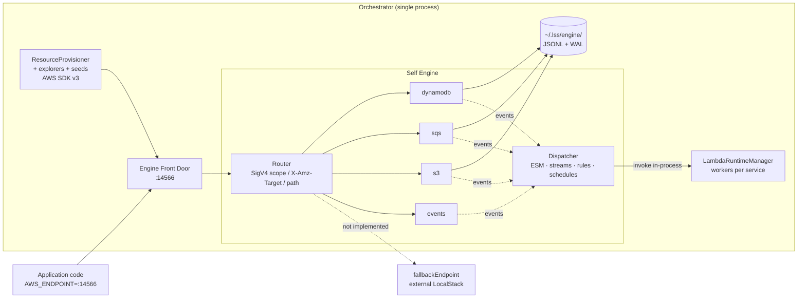

# PRD — Self Engine: native AWS emulation inside the orchestrator (replacing LocalStack)

| | |
|---|---|
| **Status** | Proposal |
| **Date** | 2026-07-10 |
| **Area** | Orchestrator (server + UI), CLI, `LssClient`, tests |
| **Related docs** | [PRD_API_LAMBDA_EMULATION.md](PRD_API_LAMBDA_EMULATION.md) (Lambda runtime + API Gateway — delivered), [README.md](README.md) (original proposal), [FEATURES.md](FEATURES.md), [CONFIGURATION.md](CONFIGURATION.md) |

---

## 1. Context and problem

LSS has already removed two burdens from local development: each service no longer boots its own LocalStack (the control plane provisions everything from CloudFormation), and serverless-offline was replaced by the native Lambda runtime + API Gateway emulation ([previous PRD](PRD_API_LAMBDA_EMULATION.md), implemented today — FEATURES.md §12).

The heaviest burden of all is still there: **LocalStack itself**.

- **Hardware cost**: a Docker container running Python plus dozens of emulated services, eating hundreds of MB of RAM and constant CPU — to serve, in practice, DynamoDB, SQS, SNS, S3 and EventBridge at development scale (10²–10⁴ items).
- **Financial cost**: community images `>= 2026.5` **require an auth token**; PRO resources are paid. The dependency stopped being "free by default".
- **Operational cost**: it needs Docker installed and running (WSL2, CI, locked-down corporate machines); real LocalStack intercepts ports 4566–4599 in some setups, causing silently wrong routing; the generated Lambda proxies pay a cold start and depend on `host.docker.internal`.
- **Boot latency**: container + healthcheck + provisioning takes tens of seconds; our own engine must boot in < 500 ms.

**This PRD proposes the `self engine`**: an opt-in mode (`lss start --self-engine`) in which the orchestrator — the same single Node process it is today — resolves the AWS resources on its own. It still receives CloudFormation templates through `POST /api/services/register`, but instead of translating them into SDK calls against LocalStack it answers the AWS APIs itself: creating a DynamoDB table becomes metadata + a local file; inserting an item becomes an append on disk; an SQS message is delivered to the handler **in-process**, with no proxy, no Docker, no container.

**Explicit priority: lightness, not speed.** The engine does not have to be the fastest — it has to consume the least RAM and CPU, hydrate data on demand and give memory back when idle.

### Why now

- The native Lambda runtime already exists and is the natural destination for events: the engine's dispatcher can call `LambdaRuntimeManager.invoke()` **in-process**, removing the HTTP hop and the Lambda proxies — exactly the "direct invocation LocalStack proxy → runtime with no HTTP hop" item listed as future work in the previous PRD.
- All of LSS's internal SDK traffic (provisioner, explorers, seeds, dynamo-proxy) already converges on a single point: `LocalStackManager.getConfig()` ([localstack-manager.ts:211](../src/server/services/localstack-manager.ts#L211)). Swapping the endpoint carries every consumer at once.
- The integration suite is **token-gated** (`LOCALSTACK_AUTH_TOKEN`) in CI today. With our own engine the suite runs on any PR, with no Docker and no secret.

## 2. Goals

1. **Selectable engine mode**: `engine: "localstack" | "self"` in the config (env `LSS_ENGINE`, CLI `--self-engine`). LocalStack stays the default until parity is proven; nothing changes for anyone who does not opt in.
2. **One AWS front door**: a single port (default **14566**) serving the DynamoDB, SQS, SNS, S3, EventBridge, Lambda (control plane) and STS protocols — so that **application code using the AWS SDK points `AWS_ENDPOINT` at the engine and works unmodified**, and LSS's own explorers/seeds/provisioner keep working unchanged.
3. **Faithful, light DynamoDB**: tables as metadata; items in a local file (JSONL snapshot + WAL); the complete expression language (KeyCondition, Filter, Update, Condition, Projection); GSI/LSI answered with correct semantics.
4. **In-process events**: SQS→Lambda, DynamoDB Streams→Lambda, S3 notifications and EventBridge rules/schedules delivered straight to the native runtime — no Lambda proxies, no idle polling.
5. **Lazy registration**: registering a service writes metadata only (KB); data hydrates on first access and dehydrates after idling, under a memory budget with LRU.
6. **Transparent fallback**: an optional `fallbackEndpoint` forwards, verbatim, any unimplemented service/operation to an external LocalStack — gradual adoption from the very first phase.
7. **Proven parity**: a differential suite (the same tests against self and LocalStack) + golden fixtures recorded against real AWS; every promise lands in FEATURES.md with an "Asserted by".

### Non-goals (locked)

- SigV4 signature verification, IAM/policies, multi-account (fixed account `000000000000`), STS beyond `GetCallerIdentity`.
- Kinesis, Step Functions, Secrets Manager/SSM, Cognito, the CloudFormation API, PartiQL, DynamoDB backup/export.
- SNS→HTTP subscriptions; S3 multipart before the hardening phase; capacity/throttling simulation.
- **Removing the LocalStack mode** — it stays for anyone who needs services outside the engine's scope.

## 3. Solution overview

**The AWS wire API is the seam.** Since the front door is mandatory anyway (requirement: unmodified application SDKs), it becomes **the single swap point**: the provisioner, the explorers and the seed manager go on using AWS SDK v3 normally — just pointed at the engine. No provisioning code is duplicated; any behavioural divergence is, by construction, an engine bug caught by daily use.



The asynchronous flow, before and after:

```
BEFORE  SQS msg → LocalStack ESM → Lambda proxy (container) → HTTP invoke :130xx → LSS Lambda Runtime → handler
AFTER   SQS msg (engine) → in-process dispatcher → LambdaRuntimeManager.invoke() → handler
```

The Lambda proxies are **absorbed, not removed**: the engine accepts `CreateFunction`/`AddPermission`/`CreateEventSourceMapping` as metadata operations (the zip is discarded, the `INVOKE_URL` env var is kept). The provisioner stays byte-identical in both modes, and the stored `INVOKE_URL` doubles as an HTTP fallback for services still running serverless-offline.

## 4. Functional requirements

### RF1 — Engine selection

- **RF1.1**: `engine: "self"` in the config (or `LSS_ENGINE=self`, or `lss start --self-engine`) boots the engine instead of LocalStack. Contradictory flags (`--pro`, `--external`, `--localstack-token`) fail fast with a clear message; `localstack*` keys are ignored with a single warning.
- **RF1.2**: Engine boot in < 500 ms, no Docker, no healthcheck polling. Engine code loaded through a dynamic `import()` — in LocalStack mode the orchestrator's RSS does not move a byte.
- **RF1.3**: The engine answers `GET /_localstack/health` with a LocalStack-shaped body (alongside `GET /_lss/health`), so `waitForReady`, the CLI poll and user tooling keep working. `GET /api/health` gains `engine: {kind, running, port}`.

### RF2 — Front door and protocols

- **RF2.1**: Routing by precedence: (1) the SigV4 credential scope from the `Authorization` header → `{service, region}` (the region now comes from the request, replacing the provisioner's mutable global `currentRegion`); (2) `X-Amz-Credential` from presigned URLs; (3) the `X-Amz-Target` prefix (`DynamoDB_20120810.`, `AmazonSQS.`, `AWSEvents.`); (4) `Action=` in a form body — including on QueueUrl paths (legacy SQS Query posts to `/000000000000/<queue>`); (5) a path heuristic (`/2015-03-31/…` → Lambda; otherwise S3 path-style, with a virtual-host peel as fallback).
- **RF2.2**: Unimplemented operation/service: with `fallbackEndpoint` configured → verbatim reverse proxy (streaming, never buffering the body); without a fallback → a 400 in the protocol's own error format, pointing at the coverage matrix in `docs/SELF_ENGINE.md`. **Never a silent success.**
- **RF2.3**: Wire mechanics that are mandatory from v1 (without them current SDKs break):
  - An **`aws-chunked`** decoder with CRC32 trailers (SDK v3 ≥ 3.729 sends it on every `PutObject`; without decoding, every upload corrupts).
  - The **`x-amzn-query-error`** header on SQS JSON errors (`QueueAlreadyExists;Sender` and friends) — SDK v3's `awsQueryCompatible` trait rewrites `err.name` from it, and the provisioner's idempotency depends on the legacy names.
  - **`MD5OfMessageBody`/`MD5OfMessageAttributes`** on `SendMessage` (clients validate them and throw on a mismatch).
  - Per-protocol error serialisation: JSON `{"__type":"…#ResourceInUseException"}`; Query `<ErrorResponse>`; S3 `<Error><Code>` with **a bodyless HEAD**; Lambda `{"Type":"User"}` + `x-amzn-ErrorType`. Every response carries `x-amzn-RequestId` (S3: `x-amz-request-id` + `x-amz-id-2`).
  - S3 quirks: the legacy XML elements `CloudFunctionConfiguration`/`CloudFunction` in the notification config; `GetBucketLocation` → an empty `<LocationConstraint/>` in us-east-1; quoted MD5 ETags; `SkipDestinationValidation` accepted silently.
- **RF2.4**: The error contract as a tested table (each row = one differential test): `ResourceInUseException`, `ResourceNotFoundException`, a TTL `ValidationException` matching `/already (enabled|disabled)/i`, `ConditionalCheckFailedException`, `QueueNameExists` + the compat header, `QueueDoesNotExist` (message contains `NonExistentQueue`), `BucketAlreadyOwnedByYou`, `NoSuchBucket`/`NoSuchKey`, `ResourceConflictException`, `ResourceAlreadyExistsException`. ARNs identical to the ones the provisioner assembles by hand (account `000000000000`; SNS delete matches on `endsWith(':' + name)`).
- **RF2.5**: An STS `GetCallerIdentity` stub (~20 lines) — plenty of application bootstraps call it before anything else and fail confusingly without it.

### RF3 — DynamoDB

- **RF3.1**: `CreateTable` with KeySchema validation (HASH/HASH+RANGE, types S/N/B), GSI/LSI, `StreamSpecification`, `BillingMode`; `DescribeTable` with the full shape ORMs (dynamoose, onetable) introspect — `TableStatus: ACTIVE` and `LatestStreamArn` present immediately (the provisioner's 5×300 ms retry passes on the first attempt).
- **RF3.2**: CRUD + `Query`/`Scan` with pagination (`ExclusiveStartKey`/`LastEvaluatedKey`, index LEKs included), `ScanIndexForward`, and the classic parity rule: **`Limit` counts items examined before the `FilterExpression`** (pinned by a differential test).
- **RF3.3**: The complete expression language: Condition/Filter (comparators, `BETWEEN`, `IN`, `AND/OR/NOT`, parentheses, `attribute_exists/_not_exists`, `attribute_type`, `begins_with`, `contains`, `size`), Update (`SET` with `+`/`-`/`if_not_exists`/`list_append`, `REMOVE`, `ADD`, `DELETE`), Projection with document paths (`a.b[0].c`), name/value placeholders with AWS's own errors for an unused/undefined placeholder. `N` arithmetic on decimal strings (no float drift).
- **RF3.4**: **GSI/LSI answered by scanning the base table in v1** — speed is not a goal; zero write amplification and zero index-maintenance bug surface (the classic one: an item whose index key changes on update). Projection semantics (KEYS_ONLY/INCLUDE) and sparse indexes are applied at read time. Materialised indexes stay a future optimisation behind the same query interface.
- **RF3.5**: Lazy TTL: expired items filtered at read and removed at compaction (emitting stream REMOVEs) — zero timers.
- **RF3.6**: Anything unsupported answers with an explicit error: transactions (hardening — trivially atomic with a single writer; the work is the `TransactionCanceledException` shape), `UpdateTable`, legacy parameters (`KeyConditions`, `Expected` → a `ValidationException` naming the equivalent), PartiQL (never). `ConsistentRead`/`ReturnConsumedCapacity` accepted (always consistent / zeros).

### RF4 — SQS and the dispatcher

- **RF4.1**: Queues with live counters (available, inFlight, delayed) — `GetQueueAttributes` reflects real state, which keeps the QueueInspector (`await-idle`, metrics) working unchanged.
- **RF4.2**: `ReceiveMessage` with **event-driven** long polling (a parked promise woken by a visible message — no polling loop); visibility timeout with a single timer per queue armed for the nearest deadline; FIFO with a per-MessageGroupId lock and a dedup window.
- **RF4.3**: Delivery to Lambda through an **in-process** event source mapping: batch ≤ `batchSize`, `maximumBatchingWindowInSeconds` honoured (the timer is only armed when a message is pending), a faithful `Records` event (receive counts, md5, eventSourceARN). Success → delete; failure → redelivery by visibility (exactly like AWS — no retry machinery of our own).
- **RF4.4**: `UpdateEventSourceMapping Enabled=false` **is** the QueueInspector's hold — hold/captured/release work from phase P2 onward.
- **RF4.5**: Target resolution in the dispatcher: `FunctionRegistry.resolve(ref)` → in-process invoke; otherwise a metadata-only function with a stored `INVOKE_URL` → POST in the AWS Invoke format (a leftover serverless-offline keeps working); otherwise a log + a failure counter. `RuntimeUnavailable` → retry with bounded backoff.
- **RF4.6**: Hardening: `RedrivePolicy`→DLQ (needs a new `redrivePolicy` field in the CFN parser), `ReportBatchItemFailures`, `FilterCriteria` (reusing the EventBridge matcher), a legacy Query protocol serialiser (old aws-sdk v2/boto3) — until then a Query request gets a loud, clear error ("your SDK predates the SQS JSON protocol").

### RF5 — S3 and DynamoDB Streams

- **RF5.1**: Buckets whose object bodies are **always on disk** (blobs by hash, streamed disk↔socket — the body never enters the heap); `PutObject` (aws-chunked), `GetObject` (Range), `HeadObject`, `DeleteObjects`, `CopyObject`, `ListObjectsV2` (XML-escaped keys, `encoding-type=url`, `KeyCount`, opaque continuation tokens).
- **RF5.2**: S3 notifications with event globs and prefix/suffix filters; post-commit fan-out via `setImmediate`; `eventVersion: 2.1` records (URL-encoded key, sequencer); 2 async retries then drop with a log.
- **RF5.3**: DynamoDB Streams: an implicit single shard (= single-writer order); INSERT/MODIFY/REMOVE records with images per `StreamViewType` in a bounded ring (1k records / 24 h); a serial tailer per ESM with TRIM_HORIZON/LATEST honoured at creation; the same batch retried ≤ `maximumRetryAttempts` (capped at 5) and then an OnFailure SQS destination carrying AWS's `DDBStreamBatchInfo` envelope. The Streams wire API (`GetShardIterator` and friends) is not needed for internal dispatch and is left for hardening.

### RF6 — EventBridge and schedules

- **RF6.1**: Buses, `PutRule`/`PutTargets`, `PutEvents` with per-entry results (a nonexistent bus → a per-entry error, not a request error); a pure, unit-testable pattern matcher (`pattern.ts`): v1 covers nested keys, OR by array, exact, `prefix`, `exists`; `anything-but`/`numeric`/`suffix`/`wildcard` in hardening. **An unknown operator is rejected at `PutRule`** (`InvalidEventPatternException`) — never silently at match time.
- **RF6.2**: Targets with `Input`/`InputPath` (dot-path subset); EventBridge's canonical envelope **with no `Records` wrapper** (the example's consumer-service depends on it).
- **RF6.3**: **Schedules** (`rate()` in v1, 6-field AWS cron next): a global timer wheel with a single pending unref'd `setTimeout`, switched off when there are no rules — this closes the documented TODO about scheduled triggers; `serverless.yml` `schedule:` already compiles to `AWS::Events::Rule`, so multi-service-sample's `cleanupExpiredOrders` starts firing with no parser change.

### RF7 — Storage, laziness and the memory budget

- **RF7.1**: Layout under `~/.lss/engine/` (or `<stateDir>/engine/` when `stateDir` is configured — test isolation preserved):

```
~/.lss/engine/
  engine.json                          # {schemaVersion, account, createdAt}
  dynamodb/<region>/<table>/
    meta.json                          # the CreateTable input + TTL + streamSpec + owning service
    snapshot.jsonl                     # 1 item per line, AttributeValue format (lossless N/B)
    wal.jsonl                          # {"seq":n,"op":"PUT"|"DEL","key":…,"item":…}
  sqs/<region>/<queue>/queue.json      # attributes only — messages live in memory
  sns/<region>/topics.json
  events/<region>/buses.json + rules/<bus|_default>/<rule>.json
  s3/<bucket>/{bucket.json, index.{snapshot,wal}.jsonl, blobs/<hash>}
  lambda/<region>/{functions.json, event-source-mappings.json}   # UUIDs preserved
```

- **RF7.2**: **Three residency levels**: (1) always resident — metadata catalogues only (~100–200 KB in a large monorepo; registering a service means writing metadata, nothing "boots"); (2) hydrated on the data plane's first touch, streamed through `readline` (never a whole-file `readFileSync`); (3) never resident — S3 bodies and WAL history.
- **RF7.3**: Flush policy: buffered appends, flushed at 20 ms / 256 KB / dehydrate / shutdown; fsync only on a compaction rename, on dehydrate and on shutdown; `fsync: true` opt-in (paranoid mode). A torn final WAL line is discarded on replay with a warning; `seq` plus the snapshot's `lastSeq` make the replay exact. **The crash-safety bar is declared**: a crash loses ≤ 20 ms of writes — the source of truth (CFN + seeds) is regenerable, and a stronger guarantee buys nothing `lss seed` cannot restore.
- **RF7.4**: Compaction when the WAL exceeds max(1 MB, 4× the snapshot), or on dehydrate/shutdown: stream to `snapshot.jsonl.tmp` → fsync → rename → truncate the WAL; TTL-expired items are removed here; S3 compaction collects orphaned blobs.
- **RF7.5**: A hard memory budget (`memoryBudgetMb`, default 128) with per-store LRU (incremental `approxBytes()`); a 60 s sweep (unref'd timer) dehydrates idle stores; AWS limits (400 KB item, batch sizes) enforced — fidelity that doubles as a memory guard; a per-queue cap (120k messages, a documented safety valve). **The timer inventory is closed: no busy polling anywhere.**
- **RF7.6**: SQS messages are memory-only with a snapshot on graceful shutdown (when `persistence: true`) — transient data does not deserve the system's heaviest write amplification.
- **RF7.7**: Footprint acceptance criteria, asserted in CI: an idle engine with 3 registered services adds ≤ 30 MB RSS over the baseline; ≤ 120 MB total hydrated on the synthetic 15-service fixture.

### RF8 — Internal compatibility

- **RF8.1**: Explorers (dynamo, s3, queues), routes, the dashboard, seeds (`assertLocalEndpoint` generalised to accept the active engine's endpoint), `LssClient.waitUntilReady()`, plugin registration and cache rehydration all work **unchanged** — every one of them already speaks SDK against the central endpoint.
- **RF8.2**: The engine's persistence plays the role of the LocalStack volume: at boot, ESMs and schedules are re-armed from `lambda/` + `events/`.
- **RF8.3**: `enableDynamoProxy` (port 8000) keeps working, pointed at the engine. `getInvokeHost()` defaults to `127.0.0.1` in self mode (nothing runs in Docker); an explicit config wins.

## 5. Technical design

### 5.1 The seam and the lifecycle

A single **lifecycle** interface (not a provisioning one — provisioning stays "speak the AWS wire"):

```ts
// src/server/engine/engine-backend.ts
export interface EngineBackend {
  readonly kind: 'localstack' | 'self';
  start(): Promise<void>;
  stop(): Promise<void>;
  isRunning(): boolean;
  getEndpoint(): string;
  getConfig(): { endpoint: string; region: string;
                 credentials: { accessKeyId: string; secretAccessKey: string } };
  healthDetail(): Record<string, unknown>;
}
```

- `backends/localstack-backend.ts`: today's `localstack-manager.ts` moved verbatim (managed/external, the Docker lifecycle). `LocalStackManager.getInstance()` becomes a deprecated facade delegating to the new `EngineManager` — **zero churn across the ~10 call sites** (index.ts, provisioner, explorers, seed-manager, routes/config, dynamo-proxy).
- `backends/self-backend.ts`: opens the store, brings up the `node:http` listener, starts the dispatcher.

An alternative was considered and rejected: a dual `ResourceProvisioner` interface (an in-process path parallel to the SDK). Rejected because the wire server is mandatory anyway — a second provisioning path would duplicate the repository's most delicate logic (`resourcesByLogicalId` → ARN resolution, idempotency by error name) and let the control plane drift from what the application's SDKs observe.

### 5.2 Module layout

```
src/server/engine/
  engine-manager.ts  engine-backend.ts
  backends/{localstack-backend,self-backend}.ts
  http/{router,sigv4,aws-chunked,errors}.ts
  http/protocols/{aws-json,query-xml,rest-xml,rest-json}.ts
  store/{engine-store,atomic,wal,hydration}.ts        # hydration = residency levels + LRU
  emulators/dynamodb/{index,schema,query,streams}.ts
  emulators/dynamodb/expressions/{lexer,parser,condition-eval,update-eval,projection-eval}.ts
  emulators/dynamodb/expressions/corpus/              # dynalite's test corpus (spec, not code)
  emulators/sqs/{index,queue,md5}.ts
  emulators/sns/index.ts
  emulators/s3/index.ts
  emulators/events/{index,pattern}.ts
  emulators/lambda-ctl/index.ts                       # proxy absorption + ESMs as metadata
  emulators/sts.ts
  dispatch/{dispatcher,sqs-poller,stream-tailer,scheduler}.ts
tests/unit/engine/**   tests/differential/**   docs/SELF_ENGINE.md
```

Each emulator imports only `http/*`, `store/*` and dispatcher types; cross-service effects (stream → lambda, s3 → lambda) go through the dispatcher. XML comes from an ~80-line template serialiser — no new dependency, no native binding (the repo's Node 20 floor rules out `node:sqlite`; `better-sqlite3` would violate zero-native-deps — hence JSONL, a unanimous decision across all three designs).

### 5.3 Configuration

```jsonc
{
  "engine": "localstack",            // "localstack" | "self" — env LSS_ENGINE
  "selfEngine": {
    "port": 14566,                   // env LSS_ENGINE_PORT
    "dataDir": "~/.lss/engine",      // <stateDir>/engine when stateDir is set
    "account": "000000000000",
    "idleUnloadMs": 300000,
    "memoryBudgetMb": 128,
    "fsync": false,
    "fallbackEndpoint": null         // e.g. "http://localhost:4566" → verbatim proxy of the unimplemented
  }
}
```

CLI: `lss start --self-engine` (→ `LSS_ENGINE=self`), `--engine-port <n>`. The existing `persistence` and `region` are honoured.

### 5.4 DynamoDB — the expression parser

A **hand-written** recursive-descent parser (~700 lines), with the grammar, the error-message tables and **dynalite's** test corpus vendored as *specification* (not as code). Rationale: dynalite's generated PEG.js parsers are ~10k lines of unreadable artifact with an AST coupled to its internal format — the "thin adapter" is exactly where the bugs would migrate to. The grammar is small and frozen since 2015; the corpus, not the code, is the transferable asset. **Spike gate** (see §10): if the spike misses the bar, the pre-committed decision is to vendor dynalite's parsers — no re-litigation.

### 5.5 Ports

| Port | Role |
|---|---|
| **14566** | Engine front door (default) — **outside the 4566–4599 range** that real LocalStack silently intercepts on Docker Desktop/WSL2 (a bind fail-fast does not detect network interception); already the repo's convention (e2e tests, eventbridge-sample) |
| 4566 | Available as a one-line opt-in (`selfEngine.port`) for a drop-in legacy `AWS_ENDPOINT` |
| 3100 / 30xx / 130xx / 8000 | Dashboard, emulated API Gateway, invoke API, dynamo-proxy — unchanged |

`EADDRINUSE` → fail-fast with a hint (most likely real LocalStack is running).

## 6. Operation matrix

The hard floor = every call LSS itself makes (provisioner, explorers, seeds); the app set = the examples plus typical handlers. Outside the matrix = an explicit error or the fallback — **never a silent success**.

| Service | v1 (internal + app) | Hardening (P5) | Never (explicit error) |
|---|---|---|---|
| DynamoDB | CreateTable, DescribeTable, DeleteTable, ListTables, Update/DescribeTimeToLive, Put/Get/Delete/UpdateItem, Query, Scan, BatchWriteItem (Unprocessed always empty), BatchGetItem | TransactWrite/GetItems, UpdateTable, legacy params, the Streams wire API | PartiQL, backup/export |
| SQS | CreateQueue (idempotent success with identical attributes), GetQueueUrl, Get/SetQueueAttributes (live counters), ListQueues, DeleteQueue, SendMessage(+Batch), ReceiveMessage (long poll), DeleteMessage(+Batch), PurgeQueue, ChangeMessageVisibility | The Query protocol, redrive APIs, tags | — |
| SNS | CreateTopic, ListTopics, DeleteTopic, GetTopicAttributes, Publish (logged/counted; no fan-out) | Subscribe/Unsubscribe + lambda/sqs delivery | HTTP subscriptions |
| S3 | CreateBucket, HeadBucket, ListBuckets, DeleteBucket, GetBucketLocation, Get/PutBucketVersioning (flag), Get/PutBucketNotificationConfiguration, ListObjectsV2, PutObject, GetObject (Range), HeadObject, DeleteObject(s), CopyObject | The multipart family, version stacks | ACL/policy APIs |
| EventBridge | Create/DeleteEventBus, PutRule, DeleteRule, Enable/DisableRule, PutTargets, RemoveTargets, PutEvents | List/Describe, TestEventPattern | Archives (accepted + warning, matching today's parser) |
| Lambda | Invoke (the handler shared with gateway-manager's invoke listener), GetFunction, Create/UpdateFunctionConfiguration (metadata), DeleteFunction, Add/RemovePermission (a recorded no-op), Create/List/Update/DeleteEventSourceMapping (Enabled = hold/release) | ListFunctions, GetFunctionConfiguration | versions/aliases |
| STS | GetCallerIdentity | — | everything else |

## 7. Compatibility and migration

- **Opt-in per LSS instance.** A hybrid split by resource type (native dynamo + s3 on LocalStack, routed by config) was **rejected**: a 2^n test matrix and broken cross-engine trigger chains. Gradual adoption comes from `fallbackEndpoint` instead (a whole unimplemented service passes straight through to a LocalStack) — every phase ships something usable on its own.
- **Keeps working by construction**: explorers, the dashboard, seeds, the QueueInspector (hold/await-idle/release), the plugin, `LssClient`, dynamo-proxy, serverless-offline (through the `INVOKE_URL` fallback).
- **What changes (documented in SELF_ENGINE.md + CHANGELOG)**: the application's `AWS_ENDPOINT` → `http://localhost:14566` (one env var; eventbridge-sample already points at 14566 and becomes the canonical demo); LocalStack volume data does not migrate (re-register + `lss seed`); aws-sdk v2 on SQS is broken until P5 (a loud, clear error); S3 multipart until P5 (a clear `NotImplemented`); proxy cold starts and the naming bug in ESM cleanup become irrelevant in self mode.
- **Rollback**: `engine: "localstack"` and back — nothing in the services' cache is engine-specific.

## 8. Delivery phases

Every phase lands in [FEATURES.md](FEATURES.md) with an "Asserted by", a CHANGELOG entry and differential coverage.

| Phase | Delivery | Acceptance criteria |
|---|---|---|
| **P0 — Seam + front door + fallback** | Extracting `EngineBackend` (compat facade), config/CLI, the router + SigV4 scope + error serialisers + aws-chunked + request ids, the `/_localstack/health` alias, the fallback proxy, the STS stub | Existing suites green in localstack mode (a neutral refactor); self boots in < 500 ms with no Docker; **the whole integration suite green with the engine in front of LocalStack through the fallback** (router transparency proven before any emulator exists) |
| **P1 — DynamoDB + storage + seeds** | §RF3 + RF7 complete (WAL/snapshot/hydration/budget) | sample-microservice registers with no Docker (non-Dynamo via the fallback); `lss seed`/`seed:clear` green; the Dynamo explorer works; a differential spec (~120 cases: Limit-before-filter, sparse GSI, index LEK, decimal arithmetic, the UpdateExpression table) identical on self vs LocalStack; RSS criteria asserted in CI |
| **P2 — Lambda-ctl + dispatcher + SQS** | Proxy/ESM absorption, SQS JSON + `x-amzn-query-error` + MD5s, in-process delivery | The order flow e2e with no Docker (POST /orders → table → SendMessage → in-process consumer → await-idle 200); hold/captured/release green; the SQS+ESM differential spec |
| **P3 — S3 + Streams** | aws-chunked round-trip, prefix/suffix notifications, INSERT/MODIFY/REMOVE with images | An upload into `incoming/` fires onUpload; the S3 explorer + `buckets.getObject` green |
| **P4 — EventBridge + minimal SNS + schedules** | The pattern matcher, Input/InputPath targets, `rate()` + cron | eventbridge-sample fully native (pattern filtering asserted); a `rate(1 minute)` fixture fires (invocation history) — **a new FEATURES line: "Schedule triggering (self-engine)"** |
| **P5 — Hardening** | The SQS Query serialiser, DLQ/RedrivePolicy (+parser), ReportBatchItemFailures, FilterCriteria, transactions, multipart, SNS subscriptions, `lss engine compact\|inspect`, docs | **CI: the full integration suite runs against the self engine, ungated, on every PR** (no token, no Docker); the LocalStack job stays gated |

P0+P1 already deliver value on their own (native DynamoDB + everything else through the fallback); P2 cuts the Docker dependency out of the typical async flow; P4 closes the schedules TODO.

## 9. Testing

1. **Per-module unit tests**: the pattern matcher and the expressions as table-driven suites that double as coverage documentation.
2. **A differential suite parameterised** by `LSS_TEST_ENGINE=self|localstack`: the same SDK v3 specs against both targets, with engine-agnostic assertions (shape/status/`err.name`, never timestamp equality). The self target runs anywhere; the LocalStack target stays behind Docker+token.
3. **Golden fixtures recorded against real AWS** (a recorder script): fidelity anchored to AWS, not to LocalStack's approximation; deliberate divergences logged in SELF_ENGINE.md.
4. **Error-contract fixtures**: `err.name`, `$metadata.httpStatusCode` and the `x-amzn-query-error` mapping (consumers enumerated row by row from the §RF2.4 table).
5. **Legacy-protocol smoke tests**: one boto3 script and one aws-sdk-v2 script for the Query branches.
6. **RAM smoke test**: 5 services, 10k seeded items, 1k mixed operations → an RSS ceiling plus a check that idle-unload really frees the maps.

## 10. De-risking spikes (before P1)

| # | Bet | Spike | Gate |
|---|---|---|---|
| 1 | A hand-written expression parser | 3 days: lexer + KeyCondition/Condition + evaluation, run against dynalite's corpus | ≥ 95% of the corpus passing and no grammar surprises → proceed; otherwise vendor dynalite's parsers (pre-decided) |
| 2 | "Internals work unmodified over the wire" | 2–3 days: capture-replay — point the real `ResourceProvisioner` + SeedManager at a stub that logs raw requests, and implement responses until `provisionResources` + `seedAll` complete on sample-microservice | Empirically enumerates the real internal floor of operations/errors and validates the SigV4 scope router against real SDK v3 traffic |
| 3 | aws-chunked/checksums with the current SDK v3 (3.974) | 1 day: a PutObject/GetObject echo server; binary round-trip through the raw SDK and through S3Explorer | Byte-for-byte equality + an accepted ETag |
| 4 | In-process ESM semantics vs the QueueInspector's expectations | 3 days: a prototype SQS store plus a poller wired to `LambdaRuntimeManager.invoke()`; run the existing hold/captured/release and await-idle integration tests unmodified | Tests green + correct `RuntimeUnavailable` behaviour across a worker restart |
| 5 | Real memory discipline | 2 days: a synthetic fixture (30 tables × 10k items), hydrate→mutate→idle→dehydrate cycles measuring RSS | Budget eviction fires; dehydrate returns RSS to the baseline (±10 MB) |

## 11. Risks and mitigation

| Risk | Impact | Mitigation |
|---|---|---|
| DynamoDB expression correctness — a silently wrong result | The highest (passes in dev, breaks in prod) | A gated spike; dynalite's corpus as the spec; golden fixtures vs real AWS; Limit/filter order pinned |
| Wire drift vs real SDKs (aws-chunked, query-compat, XML element names, MD5) | Uploads corrupt / idempotency breaks | The mandatory v1 mechanics list (§RF2.3); a differential CI run on every SDK bump; explorers + provisioner as living conformance tests |
| An error-name mismatch breaks provisioner idempotency | Re-registration fails | The error-contract table = dedicated differential tests |
| Scope creep toward "reimplement LocalStack" | Never ships | The operation matrix is the contract; outside it = a loud error or the fallback; non-goals locked in the PRD |
| Growing memory defeats the central goal | Purpose lost | A hard LRU budget, residency levels, streamed blobs, a timer inventory, an RSS assertion in CI |
| A protocol migration in a new SDK (precedent: SQS Query→JSON) | A new SDK breaks the engine | SigV4-scope routing is protocol-agnostic; serialisers are isolated; a new branch is additive |
| In-process dispatch timing diverges from LocalStack's poller | Time-sensitive tests flake | The target semantics are AWS's (redelivery by visibility, FIFO per group); an injectable clock; the lower latency is documented |
| WAL corruption/growth | Local data loss | Replay tolerant of a torn line, seq/lastSeq, atomic renames, compaction, `schemaVersion`; worst case: `rm -rf` + re-seed (acceptable in dev, documented) |
| Two engines forever = double maintenance | Team drag | The wire seam keeps ONE provisioner/explorers; the LocalStack backend is frozen, not evolved; the parameterised suite makes parity cheap |
| Port interception by real LocalStack (4566–4599) | Silently wrong routing | Default 14566 (outside the range, the repo's convention); EADDRINUSE fail-fast with a hint |
| serverless-offline users left behind | Adoption blocked | An HTTP fallback through `INVOKE_URL` in the dispatcher; a differential fixture with lambdaRuntime disabled |
| The `fallbackEndpoint` proxy corrupts streamed bodies | Confusing bugs in hybrid mode | P0's acceptance = the whole integration suite through the proxy; verbatim streaming (no buffering), only the Host rewritten |

## 12. Success metrics

- **Zero Docker** in the typical development flow (DynamoDB + SQS + S3 + EventBridge + Lambdas + APIs) from P4 onward.
- **RSS**: an idle engine ≤ +30 MB over the orchestrator; ≤ 120 MB hydrated on the 15-service fixture (vs hundreds of MB for the LocalStack container) — asserted in CI.
- **Boot**: a complete, usable environment in < 5 s after `lss start --self-engine` (vs tens of seconds of container + healthcheck).
- **CI with no secret**: the full integration suite running on every PR without `LOCALSTACK_AUTH_TOKEN`.
- **Parity**: the differential suite green on both targets; zero changes to explorers, seeds, the plugin and `LssClient`.

## 13. Open questions (maintainer's call)

1. **How important are aws-sdk v2 / boto3 clients in users' applications?** Decides whether the SQS Query serialiser (and DynamoDB's legacy params) stays in P5 or moves up to P2.
2. **Should `engine: "self"` become the default once P4 closes (LocalStack demoted to opt-in), and in which version?** Proposal: revisit at 0.9.0 with adoption data.
3. **Is there a dev AWS account available for recording the golden fixtures?** Without one the fallback is recording against LocalStack plus documented divergences — which weakens the fidelity ratchet.

## 14. Future (outside this PRD)

- Materialised GSI/LSI indexes behind the same query interface (if ever profiled as necessary).
- Short-circuiting the provisioner in self mode (skipping proxy absorption) — an optimisation, not a requirement.
- The DynamoDB Streams wire API (`GetRecords`/`GetShardIterator`) for external consumers.
- SNS→HTTP, full S3 versioning, local Step Functions (gauge demand).
- `lss engine inspect` in the UI: a live view of hydrated stores, the WAL and the memory budget.
